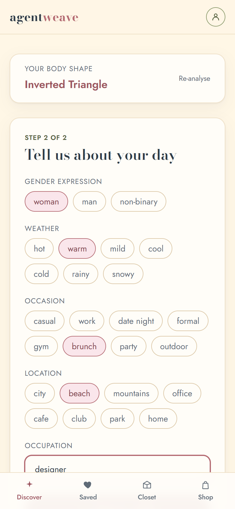
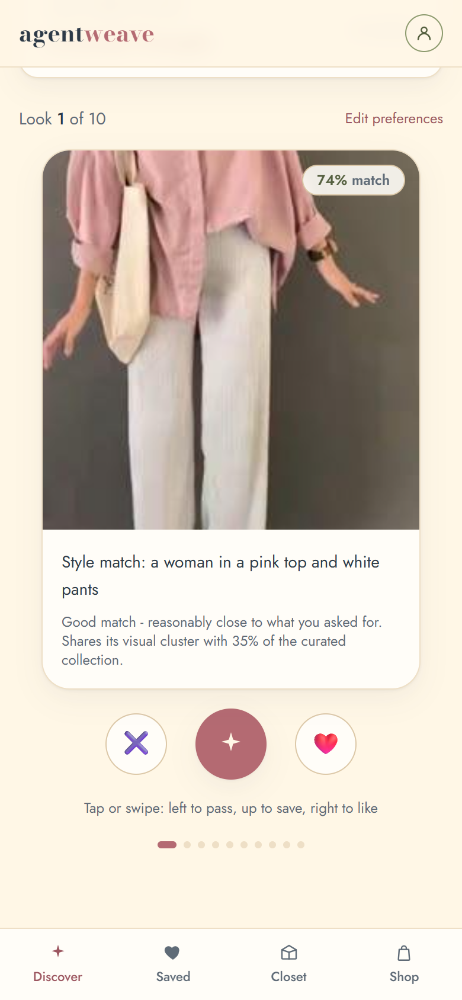
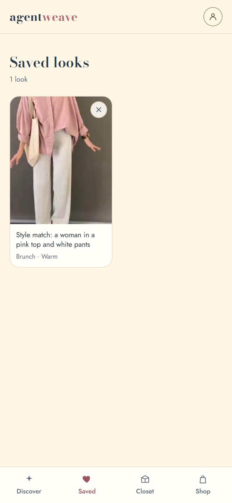
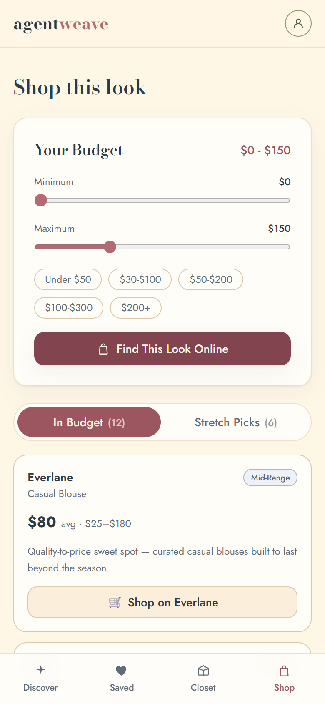
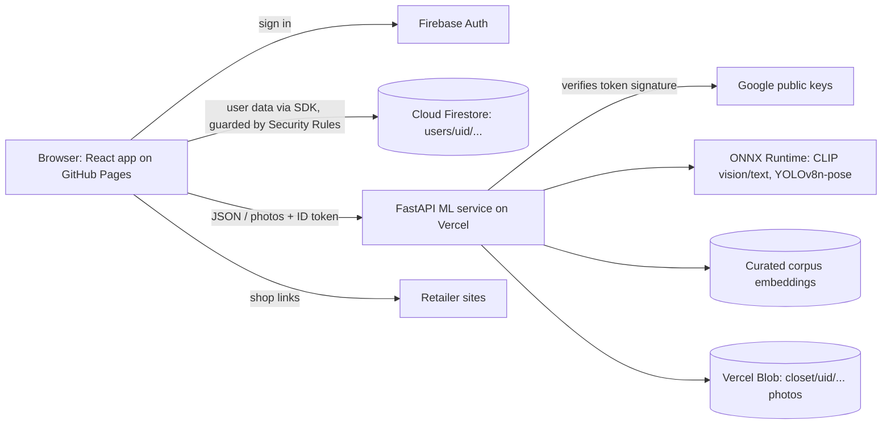

# AgentWeave

**An AI stylist you can swipe.** Tell it about your day, swipe through outfit ideas, save the ones you love, and shop them within your budget or rebuild them from clothes you already own.

**Live app:** https://dhy-ani.github.io/agentweave · **API:** https://agentweave-api.vercel.app ([health](https://agentweave-api.vercel.app/health), [docs](https://agentweave-api.vercel.app/docs))

| Preferences | Swipe deck | Saved board | Shop |
|---|---|---|---|
|  |  |  |  |

## What it is

AgentWeave turns "what should I wear?" into a two-minute flow:

1. **Describe the day.** A full-body photo gives a body-shape estimate (optional input, never a verdict), plus occasion, weather, location and occupation.
2. **Swipe.** A fine-tuned CLIP model retrieves matching looks from a curated collection of 205 outfits across 25 aesthetics. Swipe left to pass, right to like, up to save. Every action also has a button, so nothing is gesture-only.
3. **Act on it.** Saved looks go to an inspiration board. **Shop** ranks 18 real retailers against the look and your budget, split into in-budget and stretch picks. **Closet** suggests an outfit built from photos of your own clothes.

## Why it was built

Getting dressed is a daily decision, yet the tools for it are scattered. Inspiration lives on Pinterest, wardrobe apps only know what you already own, and shopping sites rank by commission rather than fit for the occasion. The [market research](docs/product/01-market-research.md) found no product joining all three. AgentWeave connects inspiration, your own closet and shopping in one flow, and it asks for taste through the lowest-effort interaction there is: a swipe.

It was also built as an end-to-end exercise in shipping an ML product properly. That meant market research and a PRD before design, Figma before code, a curated dataset and a measured model before deployment, and tests strong enough to survive mutation testing before release.

## Impact

AgentWeave has no production user base yet, so this section reports what was **measured** while building it, not adoption numbers:

| Area | Before | After |
|---|---|---|
| Recommendation coverage | 77 of 283 images indexed (ingest bug) | All 205 curated images indexed |
| Retrieval quality (held-out split) | Zero-shot CLIP: P@5 0.487, mAP@5 0.427 | LoRA-tuned CLIP: P@5 0.494, mAP@5 0.459 (served model) |
| Text-embedding fidelity in serving | 0.52 mean cosine to full precision (broken int8 path) | 0.994 (ONNX weight-only int8) |
| Backend memory | ~1.1 GB with PyTorch | ~385 MB with ONNX Runtime; fits Vercel Functions |
| Match score honesty | Every result read "29% loose match" | Calibrated per query type; ROC AUC 0.95 (text), 0.87 (image) |
| Data access | API trusted any user id sent by the browser | Firebase ID tokens verified server-side; Firestore rules limit each user to their own data |
| Test strength | No automated tests | Frontend, backend and security-rules suites; mutation scores Stryker 91.4%, mutmut 95.1% |
| Real-browser defects caught | Swipes never registered in real browsers; Google sign-in looped on GitHub Pages | Both fixed, with regression tests |

## Tech stack

| Layer | Technology | Why |
|---|---|---|
| Frontend | React 19, Tailwind CSS, `@use-gesture` | Component UI with a semantic design-token theme; gesture handling for the swipe deck |
| Auth | Firebase Authentication (email/password, Google) | Managed identity; the API verifies its ID tokens |
| Database | Cloud Firestore + Security Rules | Per-user documents with live sync; the rules are the access-control layer and are unit-tested |
| API | FastAPI on Vercel Functions | Stateless ML service: recommendations, body analysis, shop ranking, closet embeddings |
| ML | CLIP ViT-B/32 + LoRA, YOLOv8n-pose, ONNX Runtime | Fine-tuned retrieval and pose estimation, served without PyTorch |
| Files | Vercel Blob | Closet photos, stored under each user's own path |
| Quality | Jest, React Testing Library, pytest, Playwright, StrykerJS, mutmut | Unit, integration, security-rules, real-browser and mutation testing |
| Delivery | GitHub Actions, GitHub Pages, Vercel | Every check runs on every push; `main` deploys automatically |

## How authentication and data work

```mermaid
sequenceDiagram
  participant B as Browser (React)
  participant A as Firebase Auth
  participant F as Firestore
  participant API as FastAPI (ML service)
  B->>A: Sign in (email/password or Google popup)
  A-->>B: ID token (JWT, uid inside)
  B->>F: Read/write users/{uid}/... (SDK attaches the token)
  F-->>B: Allowed only if request.auth.uid == uid and the data passes validation
  B->>API: POST /closet/items + Authorization: Bearer <ID token>
  API->>API: Verify signature, audience, issuer, expiry; uid = token.sub
  API-->>B: Image URL + CLIP embedding (stored under closet/{uid}/...)
```

- **Authentication.** Firebase Authentication handles sign-up and sign-in. On a site hosted outside Firebase, Google sign-in uses a popup, because browsers that block third-party storage break the redirect flow.
- **Create, read, update and delete.** The browser writes directly to Firestore through a single data module (`frontend/src/data/userData.js`):
  - **Profile:** created on first sign-in, then updated.
  - **Saved looks:** create, live-read, delete.
  - **Swipes:** upsert.
  - **Closet items:** create, read, edit labels, delete.
  - **Shop clicks:** append-only.
- **Authorization** lives in [`frontend/firestore.rules`](frontend/firestore.rules). Every path is scoped to `users/{uid}`. Each write is checked for allowed fields, types, sizes and server-set timestamps. Anything not explicitly allowed is denied. 20 emulator-backed tests try both legitimate and malicious requests (`npm run test:rules`).
- **API access.** The ML API holds no user database. Endpoints that touch a user's files (`/closet/*`) verify the Firebase ID token's RS256 signature against Google's published keys, plus its audience, issuer and expiry. They take the user id from the token, never from the request body.

---

## How it was built, step by step

### 1. Product and market research
Before any design work, desk research covered nine competitors across visual inspiration (Pinterest), algorithmic styling (Stitch Fix), wardrobe apps (Whering, Stylebook, Acloset, Indyx), shopping aggregators (Lyst, ShopStyle/LTK) and swipe-based fashion discovery. Every figure cites its source, and claims that couldn't be verified were left out on purpose.
- [Market research](docs/product/01-market-research.md)
- [Hypothesis personas and jobs to be done](docs/product/02-personas-and-jtbd.md), with an explicit list of what interviews still need to validate
- [PRD](docs/product/03-prd.md): user stories with acceptance criteria, MoSCoW for shipped scope, RICE for the backlog, success metrics and risks

### 2. Turning research into design
Each design decision is traced back to a finding in [Research to design decisions](docs/product/04-feature-to-design-mapping.md). For example:
- Swipe is the lowest-effort way to capture taste.
- Tap buttons sit alongside the gestures because WCAG 2.2 criteria 2.5.1 and 2.5.7 require a non-drag alternative.
- The navigation has one tab per job: Discover, Saved, Closet, Shop.
- Shopping results are split into in-budget and stretch picks.

The design was done in Figma in the usual order:
1. **User flow.** A Mermaid diagram in the doc above.
2. **Low-fidelity wireframes** for all seven screens, to settle the information architecture and where each primary action lives.
3. **Design system.** The palette is Vanilla Cream `#FFF7E6`, Blush Petal `#F7C8D3`, Rosewood `#B46A72`, Sage Leaf `#A8B58A`, Misty Sky `#A9B7C6` and Midnight Lagoon `#2D3A47`. Type is Fraunces for display and Manrope for body. Small hand-drawn line doodles (purse, top, skirt, flower, shoe, sparkle) add personality.
4. **High-fidelity screens.** Mobile uses a bottom tab bar, because four tabs plus an avatar don't fit a 390 px header.

In code, colours are semantic Tailwind tokens (`canvas`, `surface`, `ink`, `muted`, `brand`, `sage`, `sky`). All text pairs meet WCAG AA contrast; the measured ratios are in the design doc. Emoji appear only on the swipe actions (pass, like) and the cart buttons. Everywhere else uses SVG icons with text labels.

### 3. Data: from raw scrapes to a curated dataset
The original model ran on 283 raw Pinterest images that were shown to users unprocessed. Only 77 of them were actually indexed, because of a bug in the ingest script. The data was fixed before any model work: `datasets/curate_dataset.py`
- removes exact (MD5) and near (perceptual hash) duplicates,
- filters out blurry, tiny and collage-shaped images,
- flags likely mislabels with CLIP zero-shot and reviews them by hand,
- re-encodes every image to a consistent size with EXIF stripped.

The result is **205 curated images in 25 aesthetic categories**, with a manifest as the single source of truth for labels.

### 4. Choosing and training the model
With about 8 images per class, fully fine-tuning CLIP's ~150M parameters would overfit, so the design keeps CLIP and adapts it cheaply:

- **Retrieval:** CLIP ViT-B/32 (LAION-2B checkpoint) with LoRA adapters on the last three attention blocks of both towers. Training uses a supervised contrastive (SupCon) loss plus an image-text InfoNCE loss. Hyperparameters were tuned with **Optuna** (TPE sampler, stratified 3-fold CV objective), with augmentation and early stopping.
- **Classifier head:** logistic regression with `C` chosen by grid search, evaluated with stratified 5-fold CV.
- **Clustering:** KMeans (k swept 4 to 16), agglomerative clustering and DBSCAN, compared on silhouette, Davies-Bouldin, purity and NMI. KMeans with k=6 was chosen. DBSCAN scored higher on raw metrics but discarded 43% of images as noise, which breaks a feature that needs every image clustered.
- **Re-ranking:** the MMR diversity weight was grid-searched (lambda 0.7).
- **Honest scoring:** a fake "trending" score built from randomly generated dates was removed. Raw CLIP cosine was misleading too: text-to-image similarity tops out around 0.3, so every result read as a "29% loose match". The match score is now calibrated per query type against known same-aesthetic pairs: 50 means "as close as a typical true match". On the curated set the calibration separates relevant from irrelevant pairs with ROC AUC 0.95 (text) and 0.87 (image). The raw cosine is still returned as `similarity`.

Results on the held-out split ([full report](backend/ai/data/eval/ablation_report.md)):

| Model | P@5 | mAP@5 | P@10 | mAP@10 | Class-separation margin |
|---|---|---|---|---|---|
| Zero-shot CLIP | 0.487 | 0.427 | 0.359 | 0.366 | 0.145 |
| LoRA-tuned CLIP | 0.494 | 0.450 | 0.372 | 0.394 | 0.191 |

The aesthetic classifier reaches macro-F1 **0.597 ± 0.052**. The gains are modest and, at this sample size, not statistically significant on their own; the report says so.

### 5. Deploying the model
PyTorch, transformers and ultralytics are too large for a fast serverless function, so the models were exported to **ONNX** and served with ONNX Runtime, numpy and `tokenizers`:

- **Quantization.** Plain dynamic int8 quantization broke the text encoder (cosine similarity about 0.65 against the fp32 model). The fix was weight-only block quantization: int8 matrices and an int4 token-embedding table. Files: vision 98.4 MB, text 55.7 MB, pose 13.5 MB.
- **Parity tests.** Against PyTorch fp32, image cosine similarity is 0.998 mean (0.975 min) and text is 0.994 mean (0.987 min). Retrieval is unchanged or better: P@5 0.494, mAP@5 0.459. Body-shape labels agree on 99.5% of images. See [onnx_parity.md](backend/ai/data/eval/onnx_parity.md).
- **Simpler search.** FAISS was replaced with a numpy matrix multiply; at 205 vectors that is faster and one dependency fewer.
- **Size and memory.** The serving bundle is about 398 MB, under Vercel's 500 MB Python limit. Memory with all models loaded is about 385 MB on Linux, down from about 1.1 GB with PyTorch.
- **Artifacts.** Model files are versioned release assets checked with SHA-256 (`backend/ai/models/manifest.json`, `backend/ai/artifacts.py`).

### 6. Auth, data and the API
- **Firebase Authentication** issues an ID token at sign-in.
- **Cloud Firestore** holds all user data under `users/{uid}`. Its Security Rules enforce ownership and validate every write, and they have their own emulator-backed test suite.
- **Stateless API.** The FastAPI service keeps no user data, so it scales to zero on Vercel. Endpoints that touch a user's files verify the ID token server-side and take the uid from it. See [How authentication and data work](#how-authentication-and-data-work).
- **API contract.** FastAPI generates the OpenAPI schema and Swagger UI at `/docs`.
- **Configuration.** Everything is set through environment variables (`frontend/.env.example`, `backend/.env.example`). Closet photos go to Vercel Blob when `BLOB_READ_WRITE_TOKEN` is set, and to local disk otherwise.
- **Upload limits.** Images are downscaled in the browser before upload because of Vercel's 4.5 MB request limit, and the server returns a clear 413 if one is still too large.
- **Health check.** `GET /health` reports which model backend is active and confirms torch is not loaded.

### 7. Testing
- **Frontend unit and integration tests.** 178 Jest and React Testing Library tests cover the pure logic modules, the Firestore data layer, the authenticated API client, every component, the full Discover → swipe → save → shop flow, and real drag gestures. Writing them exposed a bug: the "last look" message appeared before the user had acted on the last card. It is fixed.
- **Real-browser checks.** Unit tests turn animations off, so the swipe deck was also driven in headless Chrome with Playwright. That caught the most serious bug: in a real browser the react-spring animation never ran, so its completion callback never fired and no swipe or save ever registered, through buttons or drags. The card now uses a CSS transition plus a timer, so the result always fires, including with reduced motion or in a background tab. The react-spring dependency was removed.
- **Frontend mutation testing.** Mutation testing measures whether tests actually catch broken logic, not just whether lines ran. StrykerJS went from a **63.3%** baseline to **91.4%** (891 of 982 mutants killed, plus 4 timeouts) after rounds of targeted tests driven by the surviving mutants:

  | Module | Score |
  |---|---|
  | `data/userData.js` (Firestore reads and writes) | 98.2% |
  | `lib/` (API client, auth errors, budget, recommendation, swipe) | 97.2% |
  | ShoppingPanel | 95.5% |
  | FashionCard | 93.2% |
  | LoginPage | 92.9% |
  | WardrobeManager | 89.1% |
  | SavedBoard | 85.7% |
  | Dashboard | 85.0% |

  A custom Stryker ignorer (`frontend/stryker/presentation-ignorer.mjs`) skips Tailwind `className` and `style` mutants, which only affect appearance. Inline disable comments, each with a reason, cover the animation-physics lines that are intentionally untested. The remaining swipe-threshold survivors are equivalent mutants, such as `>` versus `>=` at a point where the two values can never be equal.
- **Backend tests.** 498 pytest tests: unit tests, API tests for every endpoint, token-verification tests against locally signed RS256 tokens, and real-model smoke tests. They run against deterministic fake models plugged in at the model facade. Coverage is 99% overall and 100% on `auth.py`, `routers/closet.py` and `storage.py`.
- **Backend mutation testing.** mutmut, run in WSL because it doesn't support Windows, is at **95.1%** (1484 of 1561 mutants killed, up from 85.6% before targeted tests). The survivors were reviewed: the new auth and closet code has 2, both equivalent (header-name casing), and the rest are equivalent or behaviour-neutral; the [testing guide](docs/engineering/testing.md) lists them by category.
- **Local runs without credentials.** The Firebase Auth Emulator with a `demo-` project lets anyone run the whole app without a Firebase account.

### 8. CI/CD
- **CI** (`.github/workflows/ci.yml`) runs on every push and pull request: frontend tests and build, backend tests, and both mutation suites.
- **Frontend deploy** (`.github/workflows/deploy.yml`) publishes to GitHub Pages on every push to `main`.
- **Backend deploy:** Vercel builds every push, as a preview for branches and production for `main`, from the connected GitHub repo. The model files come from the `models-v1` release and are hash-checked at build time.

---

## Architecture



## Questions a recruiter might ask

**What did you build, and what is off the shelf?**
Off the shelf: Firebase Auth and Firestore, the pretrained CLIP and YOLOv8 weights, React and FastAPI. Built here:
- the curation pipeline;
- the LoRA fine-tuning, hyperparameter search and evaluation;
- the ONNX export, quantization and parity checks;
- score calibration;
- the retrieval and re-ranking service;
- Firebase token verification;
- the Firestore data model and Security Rules;
- the whole UI, designed in Figma first;
- every test suite and the CI/CD pipeline.

**Why Firestore instead of a SQL database?**
The data is naturally per-user: profile, saved looks, swipes, closet. Firestore lets the browser read and write it directly with live updates, and the Security Rules give one auditable place for access control that is unit-tested. The trade-off is weaker cross-user querying and analytics, which this app doesn't need yet. The project started on Postgres, and the switch is recorded with its reasoning in the docs.

**How do you stop one user from reading another user's data?**
There are two independent layers:
1. **Firestore Security Rules** only allow `request.auth.uid == uid` on `users/{uid}/**`, validate every field, and deny everything else. 20 emulator tests try cross-user reads and writes, forged timestamps and unknown fields.
2. **The API** verifies each Firebase ID token's RS256 signature against Google's keys, plus its audience, issuer and expiry. It derives the uid from the token, so file paths can't be pointed at someone else's data.

**Why fine-tune with LoRA instead of training a model?**
There are 205 curated images, about 8 per class. Training from scratch, or fully fine-tuning CLIP's ~150M parameters, would overfit. LoRA adapts a small number of weights in the last attention blocks, tuned with Optuna and early stopping, and it measurably improves retrieval over zero-shot CLIP. The [ablation report](backend/ai/data/eval/ablation_report.md) is explicit that the gains aren't statistically significant at this sample size.

**How do you know the recommendations are any good?**
- A held-out split measured with Precision@k and mAP@k against zero-shot CLIP.
- A linear-probe classifier: macro-F1 0.60.
- Clustering compared across three algorithms.
- A parity suite proving the deployed ONNX model matches PyTorch.
- A calibration step whose separation of good from bad matches is measured with ROC AUC.

**How does it scale, and what does it cost to run?**
The API is stateless, so Vercel can run any number of instances and scale to zero; with ONNX it uses about 385 MB instead of 1.1 GB. Firestore and Firebase Auth are serverless and stay within the free tiers at this size. Model files are versioned GitHub release assets, checked by hash at build time.

**How is it tested, and why mutation testing?**
- Unit and integration tests with Jest and React Testing Library on the frontend, and pytest with fake models plugged in at the model boundary on the backend.
- Emulator-backed Security Rules tests.
- Playwright runs in real Chrome.
- Parity tests for the exported models.

Mutation testing (StrykerJS, mutmut) deliberately breaks the code to check that tests notice; line coverage can't show that. Scores are 91.4% (frontend) and 95.1% (backend), and every surviving mutant is explained.

**What was the hardest problem?**
Bugs that only appeared outside unit tests:
- The swipe animation library never ran in a real browser, so no swipe registered; unit tests had animations turned off.
- Google sign-in looped on GitHub Pages because browsers block the redirect flow's cross-site storage.
- A memory optimisation had silently degraded text embeddings.

Each was found by testing in a more realistic setting (Playwright, the live site, a parity check), fixed, and covered by a regression test.

**What would you do next?**
- Run usability sessions to validate the hypothesis personas.
- Replace the scraped training images with licensed ones.
- Use swipe history to personalise ranking.
- Audit the collection for body-size and skin-tone coverage.
- Add monitoring dashboards.

## Build it yourself, step by step

Steps 1 to 3, plus the install, test and build commands in steps 4 and 5, were run in order on fresh clones: the backend on Ubuntu 22.04 (WSL) and the frontend on Windows 11. The in-app flow in step 4 and the retraining in step 6 were run on the development machine. Commands are shown for macOS and Linux; the Windows equivalents follow each block.

### 0. Prerequisites

| Tool | Version used | Notes |
|---|---|---|
| Git | any recent | |
| Python | **3.12** | From python.org, `pyenv`, or `uv python install 3.12`. 3.11 or older will not work (numpy 2.4). |
| Node.js | 20 or newer (built with 24.13; CI uses 22) | Includes npm |
| Java | 11 or newer (built with 25) | Only for the local Firestore emulator |
| Disk space | about 4 GB | Mostly the one-off PyTorch environment used to build the models |

No Firebase account, cloud account or GPU is needed to build and run the app locally.

### 1. Clone

```bash
git clone https://github.com/dhy-ani/agentweave.git
cd agentweave
```

### 2. Build the model files

The serving models (ONNX, about 170 MB) are not committed. You rebuild them from the committed LoRA adapter (`backend/ai/data/lora_adapter/`) and the base CLIP checkpoint, which is downloaded from Hugging Face (about 600 MB, once). This needs a separate PyTorch environment that the running app never uses.

```bash
cd backend
python3.12 -m venv .venv-train
source .venv-train/bin/activate
pip install --upgrade pip
# CPU-only PyTorch first; without --index-url pip pulls the 2-3 GB CUDA build
pip install torch==2.12.1 torchvision==0.27.1 --index-url https://download.pytorch.org/whl/cpu
pip install -r requirements-train.txt

python ai/export_onnx.py
python ai/build_corpus_embeddings.py
deactivate
```

`export_onnx.py` merges the LoRA adapter into CLIP, exports the vision tower, the text tower and YOLOv8n-pose to ONNX, quantizes them, and rewrites `ai/models/manifest.json` with the new file hashes. In the clean-room build, both CLIP files came out byte-identical to the committed manifest (same SHA-256). The YOLO file had the same size but a different hash, because the ultralytics export embeds metadata. Don't commit the rewritten manifest unless you are publishing a new model release (`git checkout ai/models/manifest.json` restores it). `build_corpus_embeddings.py` re-embeds the 205 curated images with the exported model, so queries and the collection always come from the same model. On Windows, use `py -3.12 -m venv .venv-train` and `.venv-train\Scripts\activate`.

Optional: `python ai/onnx_parity.py` (still inside `.venv-train`) checks the exported models against PyTorch and rewrites `ai/data/eval/onnx_parity.md`.

### 3. Start the local database and auth (Firebase emulators)

Firestore and Firebase Auth run locally through the Firebase emulators, so no Firebase account or cloud project is needed. Java 11 or newer is required for the Firestore emulator.

```bash
cd frontend
npm ci
npm run emulators
```

Leave this terminal running. The Emulator UI at http://localhost:4000 lets you browse users and Firestore documents as you use the app.

### 4. Run the backend

In a new terminal:

```bash
cd backend
python3.12 -m venv .venv
source .venv/bin/activate
pip install -r requirements.txt -r requirements-dev.txt
python -m pytest

export FIREBASE_PROJECT_ID=demo-agentweave
export FIREBASE_AUTH_EMULATOR_HOST=127.0.0.1:9099
uvicorn main:app --port 8001
```

`FIREBASE_AUTH_EMULATOR_HOST` tells the API to accept the emulator's unsigned tokens; it is never set in production. On Windows (PowerShell), use `$env:FIREBASE_PROJECT_ID="demo-agentweave"` and `$env:FIREBASE_AUTH_EMULATOR_HOST="127.0.0.1:9099"` instead of the `export` lines. Check it with `curl http://localhost:8001/health`: you should see `"model_backend":"onnx"` and `"torch_imported":false`. Interactive API docs are at http://localhost:8001/docs.

### 5. Run the frontend

In a third terminal:

```bash
cd frontend
cp .env.example .env.local
npm start
```

On Windows, use `copy` instead of `cp`. Before starting, set `REACT_APP_USE_FIREBASE_EMULATORS=true` in `.env.local`.

Open http://localhost:3000, choose **Create one**, and sign up with any email and password (emulator accounts are local and disposable). Then go through the flow: upload a full-body photo, pick your preferences, swipe, and check Saved, Shop and Closet. Every saved look, swipe and closet item appears live in the Emulator UI under `users/<your uid>`.

To use a real Firebase project instead, fill in the `REACT_APP_FIREBASE_*` values, leave `REACT_APP_USE_FIREBASE_EMULATORS=false`, and run the backend with `FIREBASE_PROJECT_ID` set to that project and no emulator variable.

### 6. Run the test suites

```bash
cd frontend
npm run test:ci          # Jest + React Testing Library unit and integration tests
npm run test:rules       # Firestore Security Rules tests (starts its own emulator)
npm run test:mutation    # StrykerJS; HTML report in reports/mutation/
```

```bash
cd backend
source .venv/bin/activate
python -m pytest --cov --cov-report=term
mutmut run --max-children 8   # Linux, macOS or WSL only
mutmut results
```

Regenerate the README screenshots with `node scripts/capture-screenshots.mjs` from `frontend/`. It needs the backend, the emulator and the frontend running, and Chrome installed; pass the app URL and the Chrome path as arguments if they differ from the defaults in the script.

### 7. (Optional) Retrain the model from the raw images

This reproduces the whole ML pipeline. It runs on CPU in about 20 minutes. Run everything from `backend/` inside `.venv-train`.

1. **Curate the dataset.** Run phase 1 to dedupe, filter, normalise and flag likely mislabels into `datasets/flagged_for_review.csv`:

   ```bash
   python ../datasets/curate_dataset.py --phase1
   ```

   Review the flagged rows, record corrections in `datasets/label_overrides.csv`, then write the final manifest:

   ```bash
   python ../datasets/curate_dataset.py --finalize
   ```

2. **Split the data** into train and validation sets (`ai/data/split.json`):

   ```bash
   python ai/data_split.py
   ```

3. **Tune and train the LoRA adapter.** The Optuna sweep writes `ai/data/best_lora_hparams.json`, and the final training run writes `ai/data/lora_adapter/`:

   ```bash
   python ai/finetune_clip_lora.py --optuna 8
   python ai/finetune_clip_lora.py --train
   ```

4. **Evaluate:**

   ```bash
   python ai/train_classifier.py     # macro-F1 of a linear probe
   python ai/tune_clustering.py      # KMeans / agglomerative / DBSCAN comparison
   python ai/cluster_images.py       # writes clusters for the cluster-share signal
   python ai/tune_mmr_lambda.py      # MMR diversity weight
   python ai/evaluate_retrieval.py   # writes ai/data/eval/ablation_report.md
   ```

5. **Rebuild the serving files.** Repeat step 2 above (`export_onnx.py` and `build_corpus_embeddings.py`), then recalibrate the match score:

   ```bash
   python ai/calibrate_scores.py
   ```

Expect small run-to-run differences in the metrics: Optuna sampling and training are seeded, but CPU kernels are not fully deterministic.

### 8. Deploy

The full guide, including the release checklist, is in [docs/engineering/deployment.md](docs/engineering/deployment.md). In short:

1. **Publish the model files.** This is already done for this repo (`models-v1`); only re-export and publish a new tag if the model changes. The Vercel build downloads the files from the release and checks their hashes.
2. **Create the Vercel project.** Import the repo and set **Root Directory** to `backend`; `vercel.json` is already configured.
3. **Firestore.** In the Firebase console, create a Firestore database, then deploy the rules and indexes from `frontend/`:

   ```bash
   firebase login
   firebase deploy --only firestore:rules,firestore:indexes --project <your-firebase-project-id>
   ```

4. **Backend settings.** Set `FIREBASE_PROJECT_ID` (used to verify ID tokens) and `CORS_ORIGINS=https://<your-user>.github.io`. Attach a public Vercel Blob store, which provides `BLOB_READ_WRITE_TOKEN`.
5. **Frontend.** Set the `REACT_APP_API_URL` and `REACT_APP_FIREBASE_*` repository secrets. Pushing to `main` then publishes the frontend to GitHub Pages through `.github/workflows/deploy.yml`.

## Known limitations
- The 205 training images were scraped from Pinterest and their licences are unverified. That's acceptable for a learning project but not for production use (PRD risk R1).
- Body-shape categories are unstable by nature (see design decision D7). The feature is framed as one input among several, never a verdict.
- Shop prices are brand-level estimates. The cart buttons open the retailer's search page; there is no checkout integration.
- Deleting a closet item removes the Firestore record and then the photo. If the second call fails, the photo is left in storage; no one else can reach it, but it isn't cleaned up automatically.

## Repository layout
```
frontend/   React app, Firestore rules and indexes, Jest and rules tests, Stryker config
backend/    FastAPI app, ONNX serving, training and eval scripts (ai/), Vercel config
datasets/   curation pipeline and curated images
docs/       product research, PRD, design decisions, SDLC guide
```
